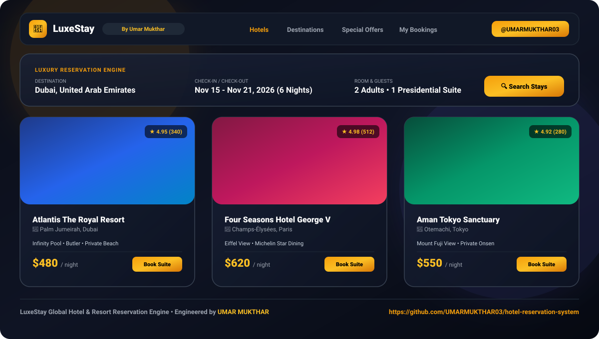

<div align="center">

# 👑 LuxeStay — Full-Stack Hotel Reservation Platform

**Engineered & Designed by [UMAR MUKTHAR](https://github.com/UMARMUKTHAR03)**

[](https://umarmukthar03.github.io/hotel-reservation-system/)
[](https://github.com/UMARMUKTHAR03)
[](LICENSE)

<br/>

<!-- Interactive High-Res Interface Preview directly inside GitHub Repo -->


</div>

---

## 🌟 Live Demo & Web App

- 🌐 **Live Website Link:** [https://umarmukthar03.github.io/hotel-reservation-system/](https://umarmukthar03.github.io/hotel-reservation-system/)
- 👨‍💻 **Creator / Maintainer:** [Umar Mukthar (@UMARMUKTHAR03)](https://github.com/UMARMUKTHAR03)
- 📦 **Repository:** [UMARMUKTHAR03/hotel-reservation-system](https://github.com/UMARMUKTHAR03/hotel-reservation-system)

---

## 🏨 Key Highlights & Features

- **Luxury Booking Engine:** Dynamic multi-criteria search by destination (Dubai, Paris, Tokyo, New York, Bali), dates, and guest capacity.
- **Exclusive Special Offers:** Curated travel deals, seasonal discounts, and instant package reservations.
- **Interactive Room Catalog:** High-resolution photo galleries, detailed amenity lists (infinity pool, spa, butler service, Michelin dining), and real-time nightly pricing.
- **Instant Booking Checkout & Confirmation:** Interactive reservation modal with real-time tax & total calculation and printable confirmation receipt.
- **Destination Discovery Radar:** Visual explorer for world-class travel hotspots.
- **Admin & Owner Dashboard:** Listing management, availability controls, and booking analytics.
- **Adaptive Dark / Light Mode:** Sleek obsidian & gold aesthetic tailored for luxury hospitality.

---

## 🛠️ Architecture & Tech Stack

| Layer | Technologies |
|---|---|
| **Frontend** | React 19, Tailwind CSS, Lucide Icons, Leaflet Maps, Context API |
| **Backend** | Node.js, Express.js (REST API, Controller-Route Architecture) |
| **Database** | MongoDB & Mongoose (Hotels, Rooms, Bookings, Users) |
| **Authentication** | Clerk Authentication & Webhook verification |
| **Media & Assets** | Cloudinary CDN image optimization |
| **Hosting** | GitHub Pages (SPA static deployment) & Node API server |

---

## 📁 Repository Structure

```
hotel-reservation-system/
├── client/                     # React Frontend Application
│   ├── src/
│   │   ├── components/         # Navbar, Hero, HotelCard, Footer, Testimonials
│   │   ├── pages/              # Home, AllRooms, RoomDetails, MyBookings, HotelMap
│   │   ├── contexts/           # ThemeContext, BookingContext
│   │   └── App.jsx
│   └── package.json
├── server/                     # Node.js & Express REST Backend
│   ├── controllers/            # Booking, Payment & Webhook Controllers
│   ├── models/                 # Mongoose Data Schemas
│   ├── routes/                 # Express API Endpoints
│   ├── configs/                # DB & Cloudinary Configuration
│   └── server.js
├── docs/
│   └── preview.svg             # In-repo UI screenshot
├── index.html                  # Self-contained GitHub Pages Live Web App
└── README.md                   # Project documentation
```

---

## 💻 Local Installation & Setup

1. **Clone the repository:**
   ```bash
   git clone https://github.com/UMARMUKTHAR03/hotel-reservation-system.git
   cd hotel-reservation-system
   ```

2. **Frontend Setup:**
   ```bash
   cd client
   npm install
   npm run dev
   ```

3. **Backend Setup:**
   ```bash
   cd server
   npm install
   npm run server
   ```

4. **Environment Variables:**
   - Client (`client/.env`):
     ```env
     VITE_CLERK_PUBLISHABLE_KEY=your_clerk_key
     VITE_API_BASE_URL=http://localhost:5000/api
     ```
   - Server (`server/.env`):
     ```env
     PORT=5000
     MONGO_URI=your_mongodb_connection_string
     CLOUDINARY_CLOUD_NAME=your_cloud_name
     CLOUDINARY_API_KEY=your_api_key
     CLOUDINARY_API_SECRET=your_api_secret
     ```

---

## 👤 Author & Attribution

**UMAR MUKTHAR**
- **GitHub:** [@UMARMUKTHAR03](https://github.com/UMARMUKTHAR03)
- **Profile:** [https://github.com/UMARMUKTHAR03](https://github.com/UMARMUKTHAR03)
- **Specialization:** Aspiring AI Engineer | Full-Stack Web Developer | Machine Learning Engineer

---

## 📄 License

This repository is licensed under the [MIT License](LICENSE) &copy; 2026 **UMAR MUKTHAR**.
